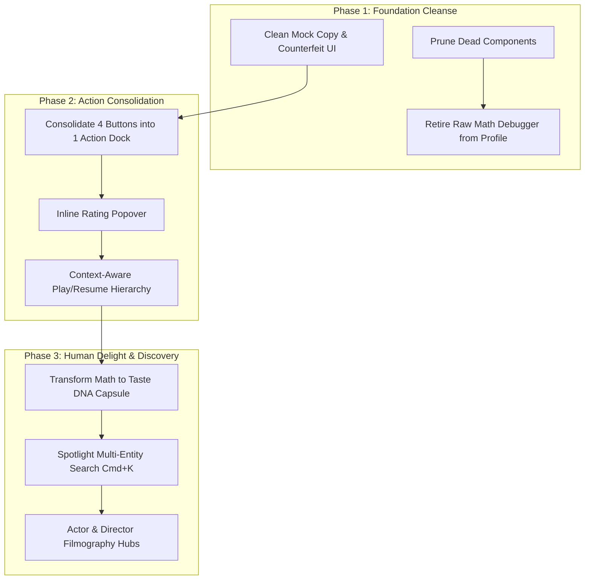

# 🎬 MovieWatcher: Experience Design Master Roadmap

> **Status:** Planning & Specification Phase  
> **Prerequisite:** Hold on development until UI element/component standardization is complete.  
> **Benchmark Reference:** [`docs/ux.md`](file:///d:/CODE/moviewatcher/docs/ux.md) (Netflix UX Architecture & Discovery Principles)

---

## 📌 Executive Summary

MovieWatcher has developed a robust recommendation backbone (Okapi BM25 weighted interaction matrix, 50,000+ MovieLens subgenre mappings, and Cloudflare D1 edge persistence). However, feature accretion has introduced cognitive friction:
1. Internal mathematical algorithms and developer diagnostics are currently exposed directly to viewers in their profile.
2. Multiple orphaned/duplicate components exist from earlier iterations.
3. Every media item presents up to four competing action buttons, inducing Hick’s Law decision paralysis.

This Experience Design suite maps out the systematic 3-phase transformation to achieve an Apple-level, frictionless streaming product.

---

## 🗺️ The Three Strategic Phases

### [Phase 1: Feature De-Cluttering & Codebase Simplification](./PHASE_1_DECLUTTERING_AND_SIMPLIFICATION.md)
* **Objective:** Remove unneeded bloat, eliminate orphan legacy files, and strip developer math dashboards out of the consumer UI.
* **Key Targets:** 6 dead component files, raw BM25 formula display in `ProfilePage.tsx`, duplicate navigation/hero patterns.

### [Phase 2: UI Action Consolidation (The Media Action Dock)](./PHASE_2_UI_ACTION_CONSOLIDATION.md)
* **Objective:** Replace the four competing action buttons (`Rate 5★`, `Watchlist`, `Mark Watched`, `Like`) with a unified, Apple-style interactive action dock.
* **Key Targets:** Hick's Law reduction, zero-modal rating flow, persistent playback memory.

### [Phase 3: Taste DNA & Next-Gen Search Experience](./PHASE_3_TASTE_DNA_AND_SEARCH.md)
* **Objective:** Turn backend recommendation weights into delightful, human-centric viewer identity ("Spotify Wrapped" for Cinema) and implement keyboard-driven `Cmd+K` multi-entity search.
* **Key Targets:** Cinephile Archetypes, narrative trope clouds, multi-entity search (Actors, Directors, Themes).

---

## 📐 Design System Standards (To Guide Component Standardization)

Before implementing these phases, all base UI primitives must conform to the following constraints:

1. **Simplicity Over Explication:** If an element requires a paragraph of explanation, the interaction model is flawed.
2. **Invisible Intelligence:** Personalization algorithms must operate invisibly to curate the feed, not demand the user inspect their weights.
3. **Restrained Color Palette:**
   - **Background:** `#000000` (Pure Black / OLED Black)
   - **Surfaces:** `#181818` / `#1f1f1f` with subtle 1px border (`#2a2a2a`)
   - **Brand Red:** `#E50914` (Reserved strictly for primary navigation & streaming playback CTAs)
   - **Taste Emerald:** `#00E054` (Reserved for Letterboxd affinity & high-confidence ratings)
   - **Text:** `#FFFFFF` (Headings), `#A1A1AA` (Body), `#71717A` (Metadata)
4. **Touch Targets & Focus States:** Minimum 44×44px interactive bounds, high-contrast focus rings for TV/keyboard navigation.
5. **Brand Typography (`Netflix Sans`):** Pure local WOFF2 hierarchy (`Light 300`, `Medium 500`, `Bold 700`). See [`TYPOGRAPHY_DESIGN_SYSTEM.md`](./TYPOGRAPHY_DESIGN_SYSTEM.md) for complete token hierarchy and rules.
